# 2048 Bot

A 2048-playing bot that taught itself the game. It is an **n-tuple network** (a large lookup-table
evaluator) trained by **temporal-difference learning** on millions of self-played games, with a
small **expectimax** search on top at play time. Everything runs on a laptop CPU: a bit-packed
Numba game engine, the training loop, parallel evaluation and replay files that a browser can
animate.

<!-- headline:start -->
**With expectimax depth 2 search, the bot averages 320.8k points and reaches 16384 in 90.5% of games at 0.124 ms per move** on one CPU core (3,000 games). Expectimax depth 3 does better on a preliminary 300 games: 333.3k average, 16384 in 92.7%, at 1.874 ms per move. Without any search (greedy), it averages 211.5k and reaches 16384 in 48.3% of games at 0.22 µs per move.
<!-- headline:end -->

## Live demo / Server

**Live demo: coming soon at [ardacakil.com/2048-bot](https://ardacakil.com/2048-bot/)** (not
deployed yet). Pick a target tile (2048, 4096, 8192 or 16384), and a small VPS plays a **new**
game with the trained network and depth-2 expectimax, streaming every move to the browser, which
replays it until the target first appears.

- **Honest games.** Every game gets a fresh random seed, sent along with the stream so anyone can
  replay it exactly (`python -m ntuple.timing --base-seed SEED`). No cherry-picking: if the bot
  dies before the target, the stream says so, together with how often this policy reaches that
  target in the evaluation.
- **Streamed as computed, paced by the browser.** The server computes about 1,700 moves per second
  on one vCPU and sends them in batches; the browser plays them back at 5 to 20 ms per move. One
  game computes at a time, others wait in a short queue with their position shown.
- **API.** `GET /api/play/{target}` (Server-Sent Events: meta, queued, init, steps, end),
  `GET /api/health`, `GET /api/stats`, served under `/2048-bot/api/` on the site. Code in
  [`src/server/`](src/server/), deployment (systemd, nginx) in [`deploy/`](deploy/README.md).
- **Frontend.** Plain HTML, CSS and JavaScript modules in [`web/`](web/), no build step and no
  third-party requests. The browser re-checks every streamed board against the rules before
  drawing it. One game per target per page load; "watch again" replays it without the server.
  Locally: `uv run uvicorn --factory server.dev:create_dev_app --reload --port 8200`, then open
  http://127.0.0.1:8200/2048-bot/.

A live game can also be watched in the terminal:
`uv run python -m server.watch --url http://127.0.0.1:8200 --target 8192` (with the server
running locally, see [Reproduce](#reproduce)). Recorded replays are in
[`results/replays/`](results/replays/).

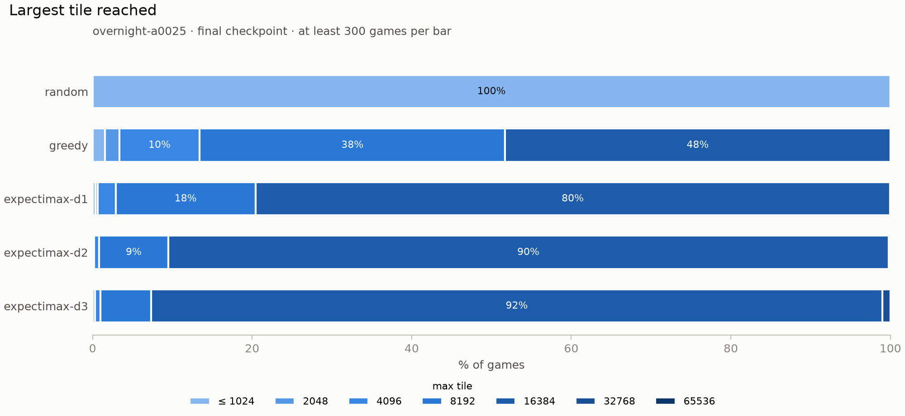

## How it works

- **Bitboard engine.** The 4×4 board is one 64-bit integer, 4 bits per cell, each storing the
  tile's exponent (1 = 2, 2 = 4, … 11 = 2048). Every possible row (65,536 of them) has its
  slide-left result and score precomputed, so a move is four table lookups; up/down reuse the
  same tables on the transposed board. Compiled with Numba.
- **N-tuple network.** The value of a position is the sum of weights looked up by small groups
  of cells ("tuples"). Four tuples of six cells each, every tuple with one weight per possible
  combination of tile exponents (16⁶ ≈ 16.8M weights, about 270 MB in total). No neural network,
  no GPU: one evaluation is 32 memory lookups.
- **8-symmetry sharing.** 2048 looks the same rotated or mirrored, so each tuple is applied to
  all 8 rotations/reflections of the board with the same weights. Every position trains the
  weights from 8 viewpoints, and the network has no favourite corner.
- **TD(0) on afterstates.** The network learns the value of the *afterstate*: the board right
  after the player's slide, before the random tile appears. During training the bot plays the
  move with the best `reward + value(afterstate)`, then nudges the previous afterstate's value
  toward what actually happened next (the next reward plus the next afterstate's value; 0 when
  the game ends). Learning rate α controls the size of each nudge.
- **Expectimax at play time.** For evaluation and play, the bot can look ahead: it averages over
  every possible random tile (a 2 with probability 0.9, a 4 with 0.1, on every empty cell) and
  assumes it will play its best move after each. **Depth = the number of random-tile layers
  searched.** Depth 0 is *greedy*: no look-ahead, exactly the training policy. Depths 1 and 2
  are exact; depth 3 skips branches whose probability of being reached is below 10⁻⁴.

## Training

Three runs of 8 hours each on a MacBook Pro (Apple M4: 4 performance + 6 efficiency cores,
16 GB), identical except for the learning rate α:

<!-- training:start -->
| Run | α | Games trained | Moves trained | Wall-clock | Games/s (avg) |
|---|---|---:|---:|---:|---:|
| `overnight-a01` | 0.1 | 13.5M | 91.7B | 8.0 h | 470 |
| `overnight-a005` | 0.05 | 12.9M | 92.5B | 8.0 h | 448 |
| `overnight-a0025` **(main model)** | 0.025 | 13.9M | 94.8B | 8.0 h | 484 |

In total 40.4M training games and 279B moves, three runs in parallel (one core each).
<!-- training:end -->

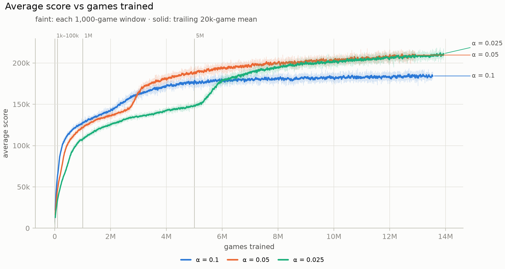

## Results

Every policy is evaluated on fresh games with the weights frozen. The main model is the final
checkpoint of the α = 0.025 run.

<!-- results:start -->
| Policy | Run | Games | Mean score ± 95% CI | Median | Max | 2048 | 4096 | 8192 | 16384 | 32768 (games) | Corner | Time/move |
|---|---|---:|---:|---:|---:|---:|---:|---:|---:|---:|---:|---:|
| random | – | 10,000 | 1,093 ± 10 | 1,048 | 5,312 | 0.0% | 0.0% | 0.0% | 0.0% | 0 | 12% | 0.10 µs |
| greedy | α = 0.1 | 10,000 | 184.3k ± 1.6k | 173.0k | 375.3k | 97.8% | 95.2% | 82.9% | 36.1% | 0 | 74% | 0.23 µs |
| greedy | α = 0.05 | 10,000 | 206.0k ± 1.8k | 176.6k | 386.5k | 98.2% | 96.1% | 85.8% | 44.9% | 0 | 78% | 0.31 µs |
| greedy | α = 0.025 | 10,000 | 211.5k ± 1.8k | 177.3k | 387.3k | 98.4% | 96.7% | 86.6% | 48.3% | 0 | 78% | 0.22 µs |
| expectimax d1 | α = 0.025 | 10,000 | 287.0k ± 1.5k | 318.5k | 610.1k | 99.6% | 99.4% | 97.1% | 79.6% | 0.06% (6) | 84% | 5.58 µs |
| expectimax d2 | α = 0.025 | 3,000 | 320.8k ± 2.3k | 341.0k | 585.3k | 99.9% | 99.8% | 99.2% | 90.5% | 0.23% (7) | 85% | 0.124 ms |
| expectimax d3 *(preliminary)* | α = 0.025 | 300 | 333.3k ± 7.5k | 357.9k | 581.6k | 100.0% | 99.7% | 99.0% | 92.7% | 1.00% (3) | 86% | 1.874 ms |

Reach columns: % of games whose largest tile reached at least that tile. *Corner*: share of moves after which the largest tile sits in a corner. *Time/move*: single-process benchmark (`--bench`) on each row's checkpoint; random is not tied to a checkpoint, its time is from the α = 0.025 benchmark (`bench.csv`). The cheap policies' timings come from a few milliseconds of play, so small differences between them are noise. Game i uses seed i for every policy (common random numbers). 95% Wilson intervals for every rate are in [`results/eval_summary.csv`](results/eval_summary.csv).
Rows marked *preliminary* have fewer than 1,000 games.

**α = 0.025 vs α = 0.05** (greedy, the same 10,000 seeds): α = 0.025 scores 5.5k more on average (95% CI 2.9k to 8.0k) and reaches 16384 3.4 percentage points more often (95% CI 2.0 to 4.8).

**Greedy strength during training** (mean score · % reaching 16384):

| Checkpoint | α = 0.1 | α = 0.05 | α = 0.025 |
|---|---:|---:|---:|
| 1k games | 10.1k · 0.0% | 8.5k · 0.0% | 6.3k · 0.0% |
| 10k games | 23.1k · 0.0% | 17.4k · 0.0% | 13.1k · 0.0% |
| 100k games | 64.9k · 0.0% | 49.5k · 0.0% | 36.2k · 0.0% |
| 1M games | 129.7k · 2.6% | 123.7k · 0.8% | 106.1k · 0.5% |
| 5M games | 180.6k · 33.3% | 187.3k · 36.7% | 148.0k · 8.8% |
| final | 184.3k · 36.1% at 13.5M | 206.0k · 44.9% at 12.9M | 211.5k · 48.3% at 13.9M |

10,000 games per cell.
<!-- results:end -->

### Figures

| | |
|---|---|
| 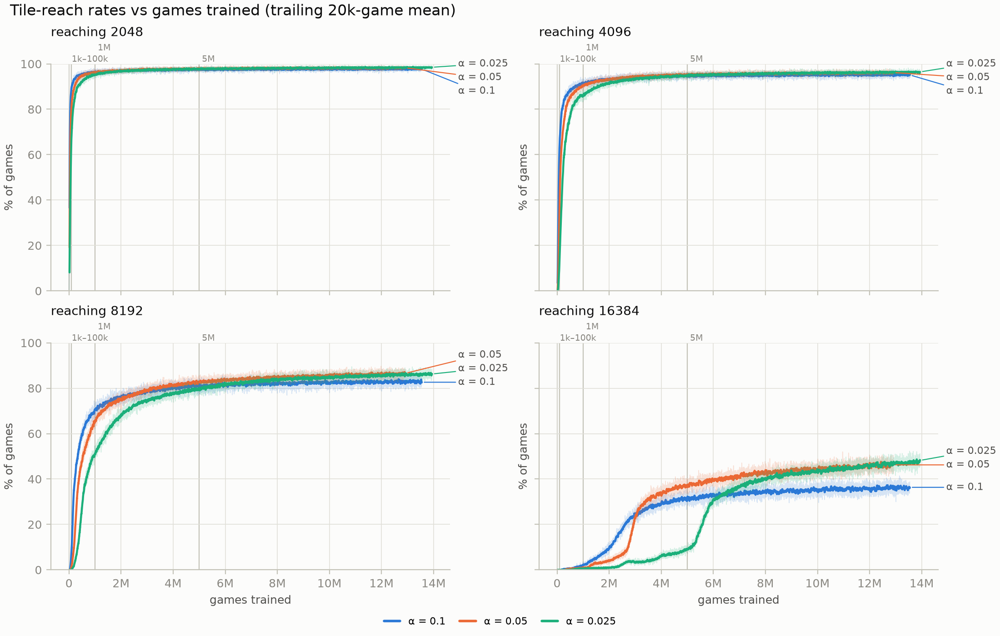 Tile-reach rates during training. | 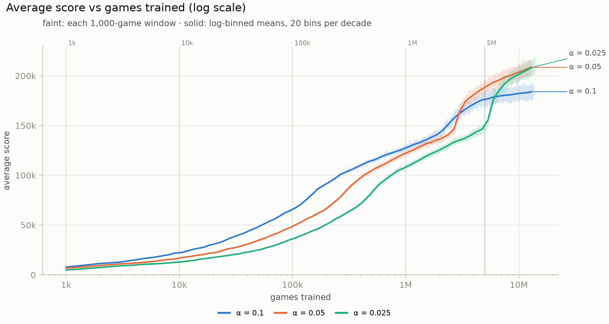 Average score on a log scale: the early learning phase. |
| 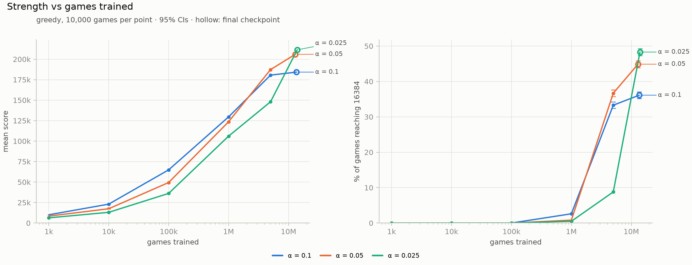 Frozen-weight greedy strength at every saved milestone. | 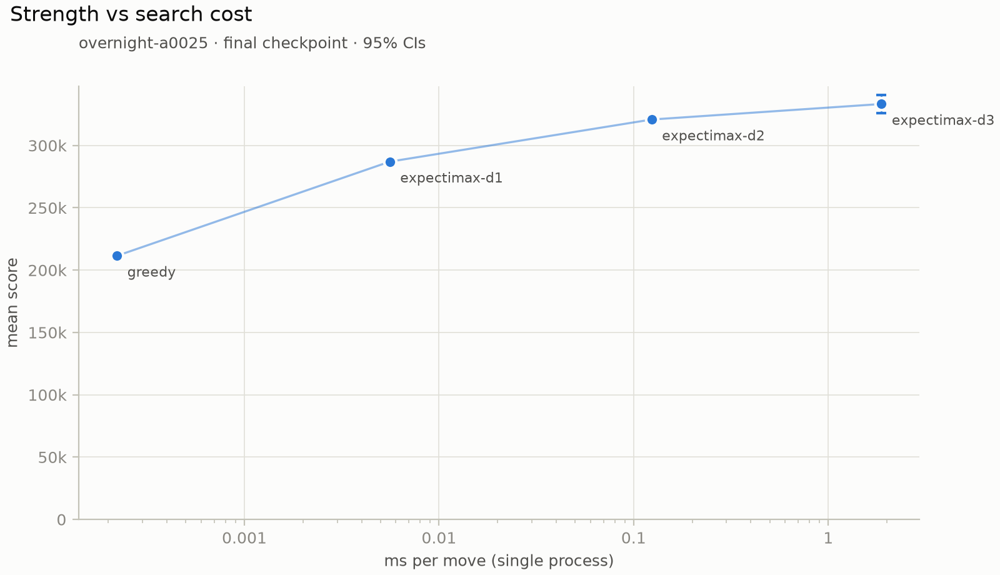 Mean score against time per move for each search depth. |
| 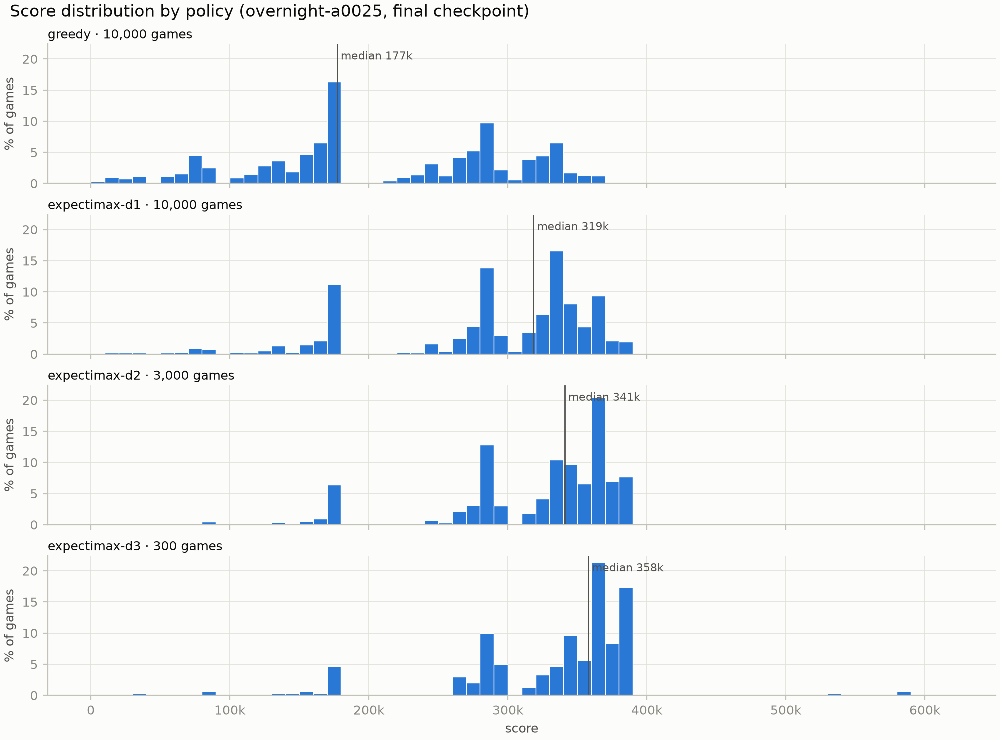 Score distribution by policy. | 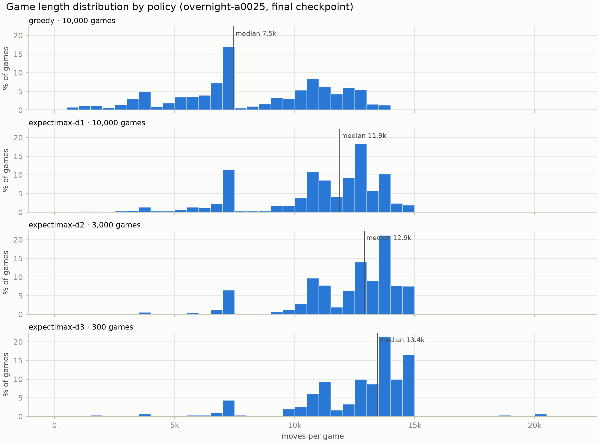 Game length by policy. |
| 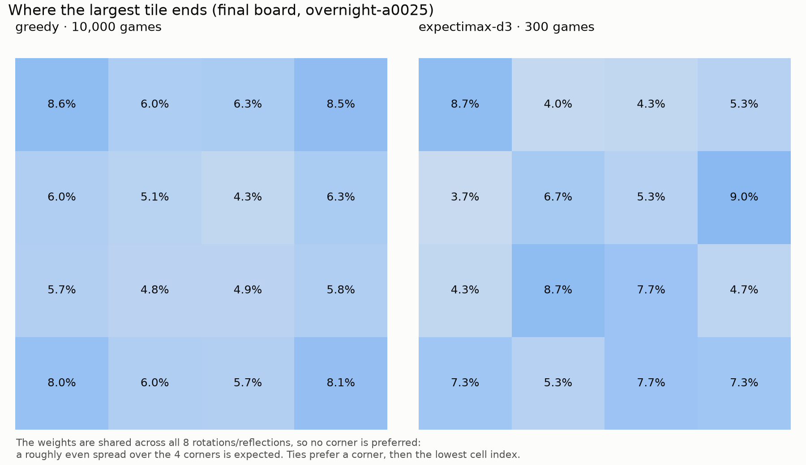 Where the largest tile ends up (final board). | 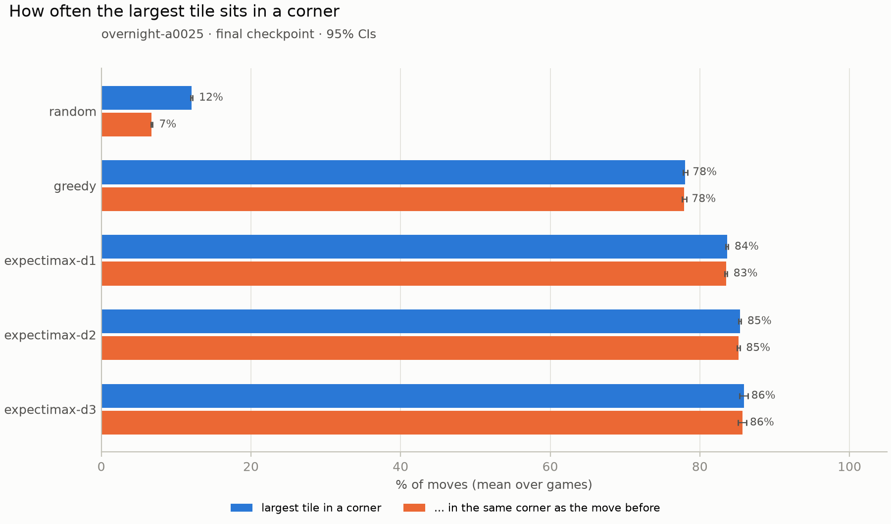 How often the largest tile sits in a corner. |
| 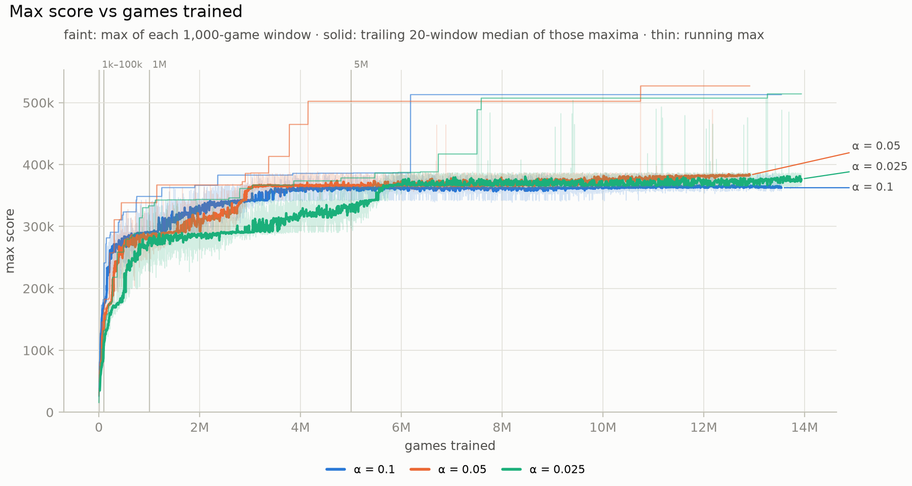 Best game per 1,000 training games. | 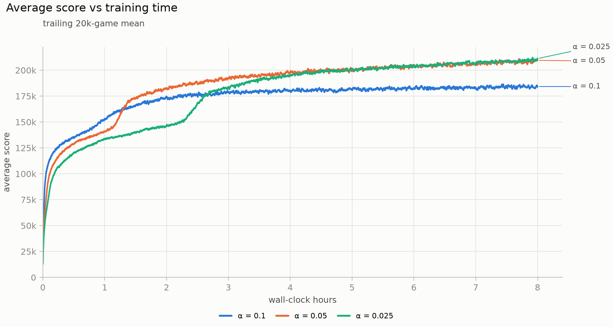 Average score against wall-clock training time. |

## Findings

<!-- findings:start -->
- **The 16384 breakthrough.** In every run the 16384 rate (20k-game smoothed) rises in a burst rather than evenly. Steepest rise over 500k games vs the run's average rise per 500k games: α = 0.1: +9.4 points (12.6% → 22.0%, 2.2M–2.7M games) vs an average of +1.3, 7×; α = 0.05: +19.0 points (8.1% → 27.1%, 2.7M–3.2M games) vs an average of +1.8, 11×; α = 0.025: +15.9 points (12.2% → 28.1%, 5.3M–5.8M games) vs an average of +1.7, 9×. The average covers the whole run, including its flat end, so it understates the climb itself. The higher the learning rate, the earlier the burst. By the end of training the 16384 rate was 36.3% (α = 0.1), 46.2% (α = 0.05), 48.2% (α = 0.025) over the last 20k games.
- **Learning-rate trade-off.** At 1M games the average score was 127.8k (α = 0.1), 122.0k (α = 0.05), 107.9k (α = 0.025); at the end 184.3k, after gaining 4.8k in the last 5M games (α = 0.1), 209.6k, after gaining 10.2k in the last 5M games (α = 0.05), 211.3k, after gaining 12.3k in the last 5M games (α = 0.025). The largest α learns fastest at first but levels off lowest.
- **Frozen weights vs training log.** Average score over the last 20k training games vs the frozen final weights on 10k fresh games: α = 0.1 184.3k → 184.3k; α = 0.05 209.6k → 206.0k; α = 0.025 211.3k → 211.5k. α = 0.05 differs by -3.6k (about 3 standard errors), more than noise. *Hypothesis, not tested:* with online TD updates the weights keep wandering from snapshot to snapshot, and this particular snapshot is slightly worse than the average over its last 20k training games. The others (α = 0.1, α = 0.025) match their logs within noise.
- **The 32768 wall.** Greedy play reached 32768 in 0 of 30,000 evaluation games; expectimax d1 in 6 of 10,000, expectimax d2 in 7 of 3,000, expectimax d3 *(preliminary)* in 3 of 300. *Game arithmetic, not a measurement:* building a 2^k tile from 2s earns (k−1)·2^k points, so one 16384 plus one each of 8192, 4096, … down to 4 is worth 393,220 points; every 4 that spawns instead of being built from two 2s lowers that by 4. The best game of each 1,000-game training window typically scores about 375k (median over the last 1M games of α = 0.025), 95% of that figure. In the evaluation games, 17 scored above 400k and 16 of them (94%) had a 32768 tile; no game reached 32768 with less than 470k. The training logs do not record tiles above 16384, but going by that evidence the training windows containing a game above 400k (α = 0.1: 1 of 13,541; α = 0.05: 10 of 12,912; α = 0.025: 29 of 13,936) most likely contained a 32768 game.
- **Search vs cost.** expectimax d1 adds 75.5k points (+36%) and +31.3 points of 16384 rate over greedy, 25× the time per move; expectimax d2 adds 33.8k points (+12%) and +11.0 points of 16384 rate over d1, 22× the time per move; expectimax d3 *(preliminary)* adds 12.5k points (+4%) and +2.1 points of 16384 rate over d2, 15× the time per move.
- **Median vs mean.** For every expectimax policy the median score is above the mean (expectimax d1: median 318.5k vs mean 287.0k; 79.6% of games reach 16384 and average 321.9k, the other 20.4% average 151.1k; expectimax d2: median 341.0k vs mean 320.8k; 90.5% of games reach 16384 and average 337.6k, the other 9.5% average 160.7k; expectimax d3 *(preliminary)*: median 357.9k vs mean 333.3k; 92.7% of games reach 16384 and average 347.3k, the other 7.3% average 155.7k). Most games build 16384; the minority that die before it score far less and pull the mean below the median (see the score histogram). Greedy is the other way round (median 177.3k, mean 211.5k): only 48.3% of its games reach 16384 (average 295.4k), so the median game is one that dies before it (those average 133.1k).
<!-- findings:end -->

## Reproduce

Requires macOS or Linux, [uv](https://docs.astral.sh/uv/) and a native (arm64 on Apple Silicon)
Python 3.12; `uv` installs the dependencies (NumPy, Numba, pandas, Matplotlib) on first run.

```bash
~/.local/bin/uv run pytest                                   # test suite

# play yourself, or watch the bot (q quits)
~/.local/bin/uv run python -m game.play
~/.local/bin/uv run python -m game.play --bot overnight-a0025 --depth 2 --delay 0.05

# train (one core per run; see TRAINING.md for the overnight setup)
caffeinate -i ~/.local/bin/uv run python -m ntuple.train --run overnight-a0025 --alpha 0.025 \
    --games 20000000 --hours 8 --seed 1 --checkpoint-every 100000000 \
    --milestones 1000,10000,100000,1000000,5000000

# evaluate (results/eval/<run>/<checkpoint>/<policy>.csv, resumable)
~/.local/bin/uv run python -m ntuple.evaluate --policy random --games 10000
~/.local/bin/uv run python -m ntuple.evaluate --runs overnight-a01,overnight-a005,overnight-a0025 \
    --checkpoints all --policy greedy --games 10000
~/.local/bin/uv run python -m ntuple.evaluate --run overnight-a0025 --depth 2 --games 10000 --workers 10
~/.local/bin/uv run python -m ntuple.evaluate --bench --run overnight-a0025 --bench-policies random,greedy,d1,d2,d3
~/.local/bin/uv run python -m analysis.report --compare overnight-a005,overnight-a0025

# replays (regenerated from their seeds and verified against the engine)
~/.local/bin/uv run python -m ntuple.replays --run overnight-a0025
~/.local/bin/uv run python -m ntuple.replays --verify results/replays/*.json

# figures: run notebooks/05_showcase.ipynb; then refresh the numbers in this README
~/.local/bin/uv run python -m analysis.readme

# live API locally, and a terminal viewer for it
~/.local/bin/uv run uvicorn --factory server.app:create_app --reload --port 8200
~/.local/bin/uv run python -m server.watch --url http://127.0.0.1:8200 --target 2048
```

## Repository structure

```
src/game/         bitboard engine, terminal player, replay format (replay.py)
src/ntuple/       n-tuple network, TD training, expectimax, player, evaluation, replays
src/analysis/     learning curves, statistics, evaluation report, README generator
src/server/       live API: FastAPI app, compute thread, queue, SSE wire format, terminal viewer
deploy/           systemd unit, nginx site, deploy script, VPS checklist
notebooks/        02_ntuple (training), 05_showcase (curves, evaluation, replays)
tests/            pytest suite
results/          eval_summary.csv, summary.json, replays/ (per-game CSVs in eval/)
figures/          every figure as PNG + SVG
TRAINING.md       how the overnight runs were set up
```

## Roadmap

- **Phase 4, server:** built (see [Live demo / Server](#live-demo--server)); deployment to the VPS next.
- **Phase 5, web frontend:** a browser client that replays streamed games with animations.
- **Improvements:** temporal-coherence learning or α decay; multi-stage networks to get past the
  32768 wall; the DQN comparison (phase 3, deferred).

## References

- M. Szubert and W. Jaśkowski, "Temporal Difference Learning of N-Tuple Networks for the Game
  2048," *IEEE Conference on Computational Intelligence and Games (CIG)*, 2014.
- I-C. Wu, K.-H. Yeh, C.-C. Liang, C.-C. Chang and H. Chiang, "Multi-Stage Temporal Difference
  Learning for 2048," *TAAI*, 2014.
- K.-H. Yeh, I-C. Wu, C.-H. Hsueh, C.-C. Chang, C.-C. Liang and H. Chiang, "Multistage Temporal
  Difference Learning for 2048-Like Games," *IEEE Transactions on Computational Intelligence and
  AI in Games*, 9(4), 2017.
- W. Jaśkowski, "Mastering 2048 With Delayed Temporal Coherence Learning, Multistage Weight
  Promotion, Redundant Encoding, and Carousel Shaping," *IEEE Transactions on Games*, 10(1), 2018.
- R. S. Sutton and A. G. Barto, *Reinforcement Learning: An Introduction*, 2nd ed., MIT Press, 2018.
